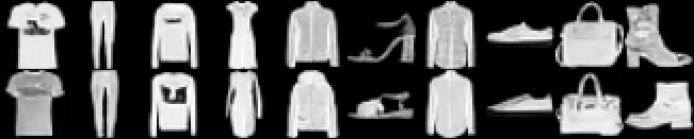
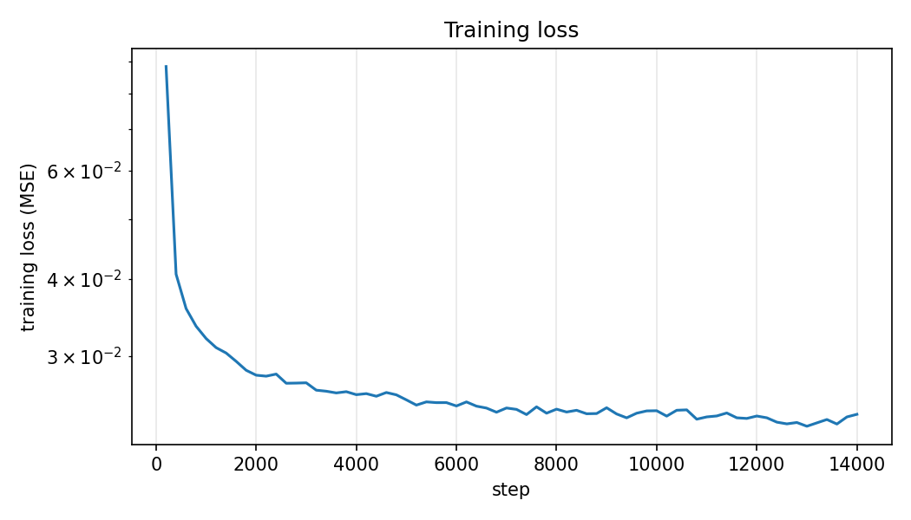
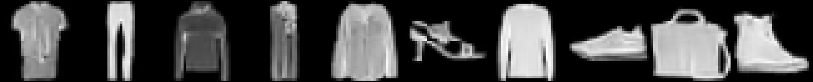

# text2img: a text-to-image diffusion model from scratch

A small text-conditioned DDPM written in PyTorch for learning purposes. Given a caption such as
*"a photo of a sneaker"*, it generates a 32x32 grayscale image. The U-Net, noise scheduler,
sampler and training loop are written from scratch; only the text encoder (CLIP) is pre-trained and frozen.



## Highlights
- **U-Net from scratch** (3.72M parameters) with sinusoidal time embeddings, FiLM-style conditioning and self-attention
- **DDPM** forward/reverse process implemented by hand (1000 steps, linear beta schedule)
- **Classifier-free guidance**: caption dropout during training, guided sampling at inference
- **EMA weights**, gradient clipping, resumable checkpoints
- Trained end-to-end on a free Kaggle GPU in about an hour

## How it works

| Component | File | Details |
|---|---|---|
| Data | `src/dataset.py` | Fashion-MNIST resized to 32x32, scaled to [-1, 1]; captions generated from 5 templates ("a photo of a {class}", ...) |
| Text encoder | `src/text_encoder.py` | Frozen CLIP ViT-B/32 text tower; the pooled 512-d embedding conditions the model |
| Model | `src/model.py` | 3-level U-Net (32→16→8 px, channels 64/128/128), one residual block per level, self-attention at 8x8 and in the bottleneck. Time + text embeddings are summed and injected into every residual block via scale/shift (FiLM) |
| Diffusion | `src/scheduler.py` | Closed-form forward noising; ancestral reverse step with posterior variance |
| Sampling | `src/sampling.py` | Reverse loop with classifier-free guidance |
| Training | `src/train.py` | Noise-prediction MSE loss, Adam, EMA, 10% caption dropout |

**Training objective:** sample a random timestep `t`, noise the image to `x_t`, and train the U-Net to predict the added noise.

## Results

- **Training:** 30 epochs, batch size 128, learning rate 2e-4, EMA decay 0.999, about 125 s/epoch on a single Kaggle GPU. Final mean training loss: 0.0237.
- **Loss curve:** 
- **Effect of guidance scale** (top to bottom: 1.0, 3.0, 6.0):

  
  
  

[Write 2-3 honest sentences here: do the generated items match their prompts? How does guidance change the images? What looks wrong or weak?]

## Setup

```bash
git clone https://github.com/[your-username]/text2img.git
cd text2img
pip install -r requirements.txt
```

A GPU is strongly recommended for training. The data downloads automatically, and CLIP weights
are fetched from the Hugging Face Hub on first run.

## Usage

**Train**
```bash
python -m src.train --data_dir ./data --out_dir ./outputs --epochs 30
# add --resume to continue from outputs/checkpoints/latest.pt
```

**Generate** (weights are available from the [Releases page]([link-to-your-release]))
```bash
python -m src.generate --weights ema_weights.pt \
    --prompt "a photo of a sneaker" "a photo of a dress" \
    --n 6 --guidance_scale 3.0 --out samples.png
```

**On Kaggle:** see `notebooks/kaggle_train.ipynb`.

## Limitations
- Trained only on Fashion-MNIST: 10 clothing classes, 32x32 grayscale
- Captions come from 5 fixed templates, so the model has not learned open-ended language; unseen phrasings may or may not work
- Sampling takes 1000 network evaluations per image (a faster sampler such as DDIM would help)
- Not a general-purpose text-to-image model; this is an educational implementation

## Ideas for future work
- Cross-attention over per-token text embeddings instead of one pooled vector
- Cosine noise schedule and DDIM sampling
- Colour datasets and 64x64 resolution (e.g. pixel-art sprites)

## References
- Ho et al., *Denoising Diffusion Probabilistic Models* (2020)
- Ho & Salimans, *Classifier-Free Diffusion Guidance* (2022)
- Radford et al., *Learning Transferable Visual Models From Natural Language Supervision* (CLIP, 2021)
- Ronneberger et al., *U-Net: Convolutional Networks for Biomedical Image Segmentation* (2015)
- Xiao et al., *Fashion-MNIST* (2017)

## License
MIT
